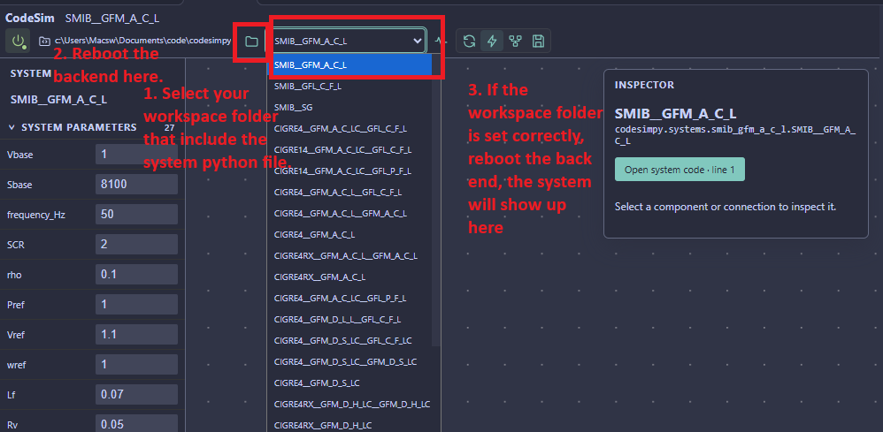

How a device model (`Device`) and a study (a SPICE netlist, `.cir`) are written, step by step, using the existing grid-forming converter `GFM_A_C_L` on an infinite bus.

(guide-overview)=
## 1. Overview

CodeSim models a power network as **devices** (converters, machines, sources, capacitors) connected by an **RL network**. You write two things:

:::{list-table}
:header-rows: 1

* - What
  - Written as
  - Contains
  - Registration
* - Component
  - a Python class derived from `Device`
  - the equations of one device
  - none for built-in components; `@device` for your own
* - System
  - a SPICE netlist (`.cir`)
  - one study: devices on buses, network, references, parameters, events, output signals
  - none: every `.cir` file in the workspace is a system
:::

Initialization, EMT and RMS simulation, small-signal and interaction analysis and the VS Code integration then work without further code.

(guide-concepts)=
## 2. Concepts

- **Per unit and time.** Each device writes its equations in per unit of its own base $(V_b, S_b)$. Derivatives are with respect to $\tau=\omega_b t$, $\omega_b=2\pi f$, so inductances and capacitances are per-unit reactances and susceptances. Times you pass in (simulation time, breakpoints, references) are in seconds.
- **Frames.** Device ports and the network use the stationary $\alpha\beta$ frame. Inside a device you work in its own rotating $dq$ frame, whose angle $\theta$ is a state ([component step 4](#guide-c-theta)). With $\bm R(\theta)=\begin{bmatrix}\cos\theta&-\sin\theta\\\sin\theta&\cos\theta\end{bmatrix}$ and $\bm J=\begin{bmatrix}0&-1\\1&0\end{bmatrix}$, a port vector is rotated in as $\bm x_{dq}=\bm R(\theta)^{\top}\bm x_{\alpha\beta}$ and out as $\bm x_{\alpha\beta}=\bm R(\theta)\,\bm x_{dq}$; $\omega L\bm J\bm i$ is the speed voltage of an inductor in $dq$.
- **Buses and ports.** Bus $i$ has one **voltage port** `Vdev[i]`, which sets the bus voltage, and one **current port** `Idev[i]`, which injects a current. An unused current port is filled with `ZeroCurrent`; a bus without a voltage port is removed from the model exactly ({ref}`guide-reduction`).

:::{list-table}
:header-rows: 1

* - Port type
  - Receives $\bm u$ ($\alpha\beta$)
  - Returns $\bm g$ ($\alpha\beta$)
  - Examples
* - `"Voltage"`
  - current it delivers
  - bus voltage
  - `Infbus`, `Capacitor`, `GFM_A_C_LC`
* - `"Current"`
  - bus voltage
  - current it injects
  - `GFM_A_C_L`, `GFL_C_F_L`, `SG`, `ZeroCurrent`
:::

The output $\bm g$ must be algebraic in the states, so a device whose terminal is an inductor is a current port. Every symbol gets the device index as suffix: state `delta` of the device `"vsg"` is `delta_vsg`.

(guide-component)=
## 3. Write a component

The example is `GFM_A_C_L` (`codesimpy/components/gfm_a_c_l.py`): a virtual-admittance grid-forming converter with a current PI loop, a circular current limit and a filter inductor, with the grid branch $R_g+jL_g$ embedded. The whole file is at the end of the section.

(guide-c-plan)=
### Step 1 — Plan the model

Without a terminal capacitor the converter's terminal is an inductor, so it is a **current port**. Its states, references and parameters:

:::{list-table}
:header-rows: 1

* - Math
  - Code
  - Kind
  - Meaning
* - $\bm i_u$
  - `irefd, irefq`
  - state 0–1
  - virtual-admittance current: the unlimited reference (the limited one is $\bm i_{ref}$, 3c)
* - $\bm i_L$
  - `iLd, iLq`
  - state 2–3
  - filter current = grid current
* - $\bm x_{cc}$
  - `xccd, xccq`
  - state 4–5
  - current-PI integrator
* - $\delta$
  - `delta`
  - state 6
  - internal-voltage angle inside the frame
* - $\theta$
  - `theta`
  - state 7
  - frame angle
* - $P_{ref}, V_{ref}, \omega$
  - `Pref, Vref, wref`
  - references
  - power set point, internal-voltage magnitude, frequency
* - $L_f, R_v, L_v$
  - `Lf, Rv, Lv`
  - parameters
  - filter inductor, virtual impedance
* - $I_{max}, K_p, K_{pc}, K_{ic}$
  - `Imax, Kp, Kp_cc, Ki_cc`
  - parameters
  - current limit, droop gain, current-PI gains
:::

The control structure (all vectors in the device $dq$ frame):

:::{figure} figures/gfm-a-c-l-control.png
:alt: Circuit and control diagram of GFM_A_C_L

Top: the bridge voltage $\bm v^{*}$ drives the filter $L_f$; the terminal voltage $\bm v_t$ (the port voltage) connects through the grid branch $R_g+jL_g$, a branch of the network, to the grid voltage $\bm v_g$. Without a terminal capacitor $\bm i_g=\bm i_L$. Bottom: the droop (APC) sets the angle $\delta$ of the internal voltage $\bm v_s$ of magnitude $V_{ref}$ ($V$ in the figure); the voltage difference $\bm e=\bm v_s-\bm v_t$ drives the virtual admittance $\bm Z_v^{-1}(s)$ to give $\bm i_u$, the circular limiter gives $\bm i_{ref}$, and the current loop gives $\bm v^{*}$.
:::

(guide-c-constructor)=
### Step 2 — Class and constructor

Subclass `Device` and pass the port type, the parameters with their defaults (per unit of the device base), the state names and the reference names. The state order chosen here is the order of `f`, of the initial state and of the indices in step 4.

```{code} python
:caption: class and constructor
class GFM_A_C_L(Device):
    """GFM · A: virtual admittance + current PI · C: circular limit on the current reference · L: no terminal capacitor (current port; the port voltage is the PCC voltage)."""

    def __init__(self, Vb: float, Sb: float, index: str) -> None:
        super().__init__(
            Vb, Sb, "Current", index,
            {
                "Lf": 0.07, "Rv": 0.1, "Lv": 0.01,
                "Imax": 1.5, "Kp": 0.05,
                "Kp_cc": 20.0, "Ki_cc": 5.0,
            },
            ("irefd", "irefq", "iLd", "iLq", "xccd", "xccq",
             "delta", "theta"),
            ("Pref", "Vref", "wref"),
        )
```

`Device.__init__` creates the symbols, suffixed with the device index: `self.x` (states), `self.u` (port input, here the terminal voltage $\bm v_{\alpha\beta}$), `self.uref` (references) and `self.p[name]["sym"]` (parameters; the value is in `self.p[name]["num"]`). It then calls `getStateAndOutputEquationsSym` (step 3) once and stores `f` and `g`.

(guide-c-equations)=
### Step 3 — State and output equations

`getStateAndOutputEquationsSym` returns `f` ($d\bm x/d\tau$, one row per state, in state order) and `g` (the port output in $\alpha\beta$). Write parameters as symbols so they can be changed without rebuilding, and use only differentiable functions (`sp.Abs`, `sp.sqrt`, `sp.tanh`; no `Piecewise`, `Min`/`Max` or `if`). The method is built in six parts.

#### 3a. Symbols and rotation

Unpack states and references and build $\bm J$ and $\bm R(\theta)$.

```{code} python
:caption: getStateAndOutputEquationsSym — symbols
def getStateAndOutputEquationsSym(self):
    iref = sp.Matrix(self.x[0:2])
    current = sp.Matrix(self.x[2:4])
    xcc = sp.Matrix(self.x[4:6])
    delta, theta = self.x[6:8]
    Pref, Vref, w = self.uref
    pccVoltageStationary = sp.Matrix(self.u)

    p = lambda name: self.p[name]["sym"]
    J = sp.Matrix([[0, -1], [1, 0]])
    rotation = sp.Matrix([
        [sp.cos(theta), -sp.sin(theta)],
        [sp.sin(theta), sp.cos(theta)],
    ])
```

#### 3b. Port voltage

The port voltage is the terminal (PCC) voltage, rotated into the frame: $\bm v_t=\bm R(\theta)^{\top}\bm v_{\alpha\beta}$. The device contains no grid impedance. When the PCC has no capacitor, the grid branch $R_g+jL_g$ is a branch of the network and RLGrid removes the PCC exactly with its KCL ({ref}`guide-reduction`).

```{code} python
:caption: getStateAndOutputEquationsSym — port voltage
# The port voltage is the PCC voltage. A grid branch behind a PCC without a
# capacitor is handled by the network (RLGrid.localDAEreduction).
pccVoltage = rotation.T * pccVoltageStationary
```

#### 3c. Circular current limit

The unlimited current $\bm i_u$ from the virtual admittance (3e) is scaled onto the circle $I_{max}$ when it is outside. The code writes the $\min$ with an absolute value so that it can be differentiated.

$$
\bm i_{ref}=\bm i_u\,\min\!\left(1,\;\frac{I_{max}}{|\bm i_u|}\right)
$$

```{code} python
:caption: getStateAndOutputEquationsSym — current limit
squaredMagnitude = iref.dot(iref)
denominator = sp.sqrt((
    squaredMagnitude + p("Imax")**2
    + sp.Abs(squaredMagnitude - p("Imax")**2)
) / 2)
limitedReference = p("Imax") * iref / denominator
```

#### 3d. Current loop and filter

The bridge voltage command feeds forward a part $K$ of the terminal voltage, decouples the filter's speed voltage and adds a PI on the current error:

$$
\begin{aligned}
\bm v^{*} &= K\,\bm v_t+\omega L_f\bm J\,\bm i_L+\left(K_{pc}+\frac{K_{ic}}{s}\right)\left(\bm i_{ref}-\bm i_L\right)\\
K &= 0.5
\end{aligned}
$$

The integral part is the state $\bm x_{cc}$ (`xccd, xccq`). With $\bm v^{*}$ in the filter inductor, $L_f\,d\bm i_L/d\tau = \bm v^{*}-\bm v_t-\omega L_f\bm J\,\bm i_L$, so the speed voltages cancel:

$$
L_f\,\frac{d\bm i_L}{d\tau}=\left(K_{pc}+\frac{K_{ic}}{s}\right)\left(\bm i_{ref}-\bm i_L\right)-(1-K)\,\bm v_t
$$

```{code} python
:caption: getStateAndOutputEquationsSym — current loop
currentError = limitedReference - current
controllerVoltage = (
    p("Kp_cc") * currentError + p("Ki_cc") * xcc
)
# Converter voltage = controller output + half of the PCC voltage (feedforward).
dcurrent = (controllerVoltage - pccVoltage / 2) / p("Lf")
```

These equations are linear in the port voltage $\bm v_t$. That is what lets RLGrid remove a PCC without capacitor exactly: with the grid branch, $\bm v_t=\bm v_g+R_g\bm i+L_g\,d\bm i/d\tau$ and $d\bm i/d\tau$ depends linearly on $\bm v_t$, which gives the effective inductance $L_f+L_g/2$.

#### 3e. Droop and virtual admittance

The droop (APC) moves the angle $\delta$ of the internal voltage $\bm v_s$ with the power error. The voltage difference $\bm e$ drives the virtual admittance (AVC), whose current $\bm i_u$ is the unlimited reference:

$$
\begin{aligned}
\dot\delta &= K_p\left(P_{ref}-\bm v_t\cdot\bm i_L\right)\\
\bm v_s &= V_{ref}\begin{bmatrix}\cos\delta\\\sin\delta\end{bmatrix}\\
\bm e &= \bm v_s-\bm v_t\\
\bm i_u &= \bm Z_v^{-1}(s)\,\bm e,\qquad \bm Z_v(s)=R_v\bm I+L_v\left(s\bm I+\omega\bm J\right)
\end{aligned}
$$

The code writes $\bm Z_v^{-1}(s)$ as the state equation of $\bm i_u$ (`diref`).

```{code} python
:caption: getStateAndOutputEquationsSym — droop and virtual admittance
ddelta = p("Kp") * (
    Pref - pccVoltage.dot(current)
)
internalVoltage = Vref * sp.Matrix([
    sp.cos(delta), sp.sin(delta),
])
diref = (
    internalVoltage - pccVoltage - p("Rv") * iref
    - w * p("Lv") * J * iref
) / p("Lv")
```

#### 3f. Return f and g

The rows of `f` follow the state order of step 2; the last row is the frame angle. The output is the current rotated back to $\alpha\beta$.

$$
\begin{aligned}
\bm f &= \left[\frac{d\bm i_u}{d\tau},\;\frac{d\bm i_L}{d\tau},\;\frac{d\bm x_{cc}}{d\tau},\;\dot\delta,\;\dot\theta\right],\qquad
\frac{d\bm x_{cc}}{d\tau}=\bm i_{ref}-\bm i_L,\quad \dot\theta=\omega\\
\bm g &= \bm i_{\alpha\beta}=\bm R(\theta)\,\bm i_L
\end{aligned}
$$

```{code} python
:caption: getStateAndOutputEquationsSym — return
return (
    list(diref) + list(dcurrent) + list(currentError)
    + [ddelta, w],                    # f
    list(rotation * current),         # g
)
```

(guide-c-theta)=
### Step 4 — The frame angle θ and the RMS states

Two class attributes, given as positions in the state list:

```{code} python
:caption: class attributes
thetaIndices = (7,)
rmsDynamicIndices = (6,)  # delta
```

**What $\theta$ is.** $\theta$ is the angle of the device's own $dq$ frame measured in the stationary $\alpha\beta$ frame. Every vector inside the device ($\bm i_L$, $\bm i_u$, $\bm x_{cc}$, $\bm v_s$) is written in this frame, and $\bm R(\theta)$ connects it to the port. In `GFM_A_C_L` the frame turns at the frequency reference, $\dot\theta=\omega$, and the internal voltage sits at $\delta$ *inside* it, so its absolute angle is $\theta+\delta$ and its frequency $\omega+\dot\delta$. $\theta$ is the clock of the frame; $\delta$ is the load angle that the droop moves.

**Why it is special.** In steady state every other state is constant, but $\theta$ keeps growing ($\dot\theta=\omega\ne0$). So:

- **Initialization.** The states in `thetaIndices` have no steady-state equation. All other rows must satisfy $f=0$ and are solved; $\theta$ is held at the value from `initFromPowerFlow` (step 6), normally the bus angle so the frame is aligned with the bus voltage.
- **RMS model.** The RMS model is written in a common $DQ$ frame turning at 1 pu, and each $\theta$ is measured relative to it: its row becomes $\dot\theta=\omega-1$, which is zero in steady state at nominal frequency. $\theta$ always stays differential.
- **Absolute angle.** Only angle differences matter physically. One device, the infinite bus, fixes the reference angle in the power flow.

$\theta$ in each existing device:

:::{list-table}
:header-rows: 1

* - Device
  - $\theta$ state
  - $\dot\theta$
  - Meaning
  - Initial value
* - `Infbus`
  - `theta` (0)
  - $\omega_0=1$
  - angle of the grid voltage $A\,[\cos\theta,\sin\theta]$
  - bus angle (0: the slack fixes it)
* - `Capacitor`
  - `thetaC` (2)
  - $\omega=1$
  - a frame at nominal speed in which the capacitor voltage is written
  - bus angle, so $\bm v_C=[V,0]$
* - `GFM_A_C_L`, `GFM_A_C_LC`
  - `theta`
  - $\omega_{ref}$
  - control frame at the frequency reference; the internal voltage is at $\delta$ inside it
  - bus angle
* - `GFL_C_F_L`
  - `theta` (4)
  - $\omega_{PLL}$
  - PLL angle: the PLL turns the frame until $v_q=0$
  - bus angle
* - `SG`
  - `theta` (6)
  - $\omega$ (rotor speed, a state)
  - rotor angle: the frame is fixed to the rotor's $d$ axis
  - bus angle − load angle
* - `ZeroCurrent`
  - –
  - –
  - no states
  - –
:::

**RMS states.** `rmsDynamicIndices` lists the slow states that stay differential in the RMS model besides $\theta$: here $\delta$. The fast states (currents, integrators of the current loop) become algebraic, $0=f$.

(guide-c-powerflow)=
### Step 5 — Power-flow equations

Initialization first solves a power flow in the bus voltage $V$, the bus angle and the injected power $P, Q$. The device returns exactly two equations $=0$. In steady state $\bm i_L=[P,-Q]/V$ in a frame aligned with the bus voltage, so:

$$
\begin{aligned}
\bm v_t &= \begin{bmatrix}V\\0\end{bmatrix}\\
\bm v_s &= \bm v_t+(R_v\bm I+\omega L_v\bm J)\,\bm i_L\\
0 &= P_{ref}-\bm v_t\cdot\bm i_L\\
0 &= |\bm v_s|^2-V_{ref}^2
\end{aligned}
$$

```{code} python
:caption: getPowerFlowEquations
def getPowerFlowEquations(self, V, theta, P, Q):
    del theta
    w = self.uref[2]
    current = sp.Matrix([P / V, -Q / V])
    J = sp.Matrix([[0, -1], [1, 0]])
    pccVoltage = sp.Matrix([V, 0])
    internalVoltage = (
        pccVoltage + self.p["Rv"]["num"] * current
        + w * self.p["Lv"]["num"] * J * current
    )
    return [
        self.uref[0] - pccVoltage.dot(current),
        internalVoltage.dot(internalVoltage) - self.uref[1] ** 2,
    ]
```

References appear as symbols (`self.uref`; their values are substituted at the initialization time) and parameters as numbers (`self.p[name]["num"]`).

(guide-c-init)=
### Step 6 — Initial state

From the power-flow result, return a value for every state, in state order. The guess needs to be on the right branch; the exact steady state is then solved from $f=0$.

$$
\begin{aligned}
\bm i_u &= \bm i_L=\frac{[P,-Q]^\top}{V}, & \bm x_{cc} &= \frac{\bm v_t}{2K_{ic}}\\
\delta &= \angle\bm v_s, & \theta &= \theta_{bus}
\end{aligned}
$$

($\bm x_{cc}$ supplies the half of $\bm v_t$ that the bridge does not feed forward.)

```{code} python
:caption: initFromPowerFlow
def initFromPowerFlow(self, V, theta, P, Q):
    w = 1.0
    current = np.array([P / V, -Q / V])
    J = np.array([[0.0, -1.0], [1.0, 0.0]])
    pccVoltage = np.array([V, 0.0])
    internalVoltage = (
        pccVoltage + self.p["Rv"]["num"] * current
        + w * self.p["Lv"]["num"] * J @ current
    )
    xcc = 0.5 * pccVoltage / self.p["Ki_cc"]["num"]
    delta = np.arctan2(internalVoltage[1], internalVoltage[0])
    return np.r_[current, current, xcc, delta, theta]
```

(guide-c-signals)=
### Step 7 — Output signals (optional)

Every system already returns the bus signals (|V|, angle, P, Q, line currents) and all states. Return from `calculateSignals` only what is neither: here the terminal voltage and its power, because the PCC may be a bus without a voltage device. `x` has one row per time sample and the device's states as columns, `u` is the port input in $\alpha\beta$ on the device base (the terminal voltage of a current-port device), `uref` the references. The values are on the device base; the frontend shows them under the component.

```{code} python
:caption: calculateSignals
def calculateSignals(self, time_s, x, u, uref):
    """Terminal (PCC) voltage and its power: the PCC may be a bus without a voltage device."""
    x, u = np.asarray(x), np.asarray(u)
    current, theta = x[:, 2:4], x[:, 7]
    cos, sin = np.cos(theta), np.sin(theta)
    vd = cos * u[:, 0] + sin * u[:, 1]
    vq = -sin * u[:, 0] + cos * u[:, 1]
    return {
        "pccVoltage": np.hypot(vd, vq),
        "activePower": vd * current[:, 0] + vq * current[:, 1],
        "reactivePower": vq * current[:, 0] - vd * current[:, 1],
    }
```

:::{note}
**No registration.** A component is a plain `Device` subclass that a system imports and creates. Put your own in your workspace next to the system that uses it (the workspace folder is on the import path), or in `codesimpy/components/`.
:::

::::{dropdown} Full file: codesimpy/components/gfm_a_c_l.py
```{code} python
:caption: codesimpy/components/gfm_a_c_l.py
"""GFM_A_C_L: Virtual-admittance GFM without a PCC capacitor."""

import numpy as np
import sympy as sp

from ..core import Device


class GFM_A_C_L(Device):
    """GFM · A: virtual admittance + current PI · C: circular limit on the current reference · L: no terminal capacitor (current port; the port voltage is the PCC voltage)."""
    thetaIndices = (7,)
    rmsDynamicIndices = (6,)  # delta

    def __init__(self, Vb: float, Sb: float, index: str) -> None:
        super().__init__(
            Vb, Sb, "Current", index,
            {
                "Lf": 0.07, "Rv": 0.1, "Lv": 0.01,
                "Imax": 1.5, "Kp": 0.05,
                "Kp_cc": 20.0, "Ki_cc": 5.0,
            },
            ("irefd", "irefq", "iLd", "iLq", "xccd", "xccq",
             "delta", "theta"),
            ("Pref", "Vref", "wref"),
        )

    def getStateAndOutputEquationsSym(self):
        iref = sp.Matrix(self.x[0:2])
        current = sp.Matrix(self.x[2:4])
        xcc = sp.Matrix(self.x[4:6])
        delta, theta = self.x[6:8]
        Pref, Vref, w = self.uref
        pccVoltageStationary = sp.Matrix(self.u)

        p = lambda name: self.p[name]["sym"]
        J = sp.Matrix([[0, -1], [1, 0]])
        rotation = sp.Matrix([
            [sp.cos(theta), -sp.sin(theta)],
            [sp.sin(theta), sp.cos(theta)],
        ])

        # The port voltage is the PCC voltage. A grid branch behind a PCC without a
        # capacitor is handled by the network (RLGrid.localDAEreduction).
        pccVoltage = rotation.T * pccVoltageStationary

        squaredMagnitude = iref.dot(iref)
        denominator = sp.sqrt((
            squaredMagnitude + p("Imax")**2
            + sp.Abs(squaredMagnitude - p("Imax")**2)
        ) / 2)
        limitedReference = p("Imax") * iref / denominator
        currentError = limitedReference - current
        controllerVoltage = (
            p("Kp_cc") * currentError + p("Ki_cc") * xcc
        )
        # Converter voltage = controller output + half of the PCC voltage (feedforward).
        dcurrent = (controllerVoltage - pccVoltage / 2) / p("Lf")

        internalVoltage = Vref * sp.Matrix([
            sp.cos(delta), sp.sin(delta),
        ])
        diref = (
            internalVoltage - pccVoltage - p("Rv") * iref
            - w * p("Lv") * J * iref
        ) / p("Lv")
        ddelta = p("Kp") * (
            Pref - pccVoltage.dot(current)
        )

        outputCurrent = rotation * current
        return (
            list(diref) + list(dcurrent) + list(currentError)
            + [ddelta, w],
            list(outputCurrent),
        )

    def getPowerFlowEquations(self, V, theta, P, Q):
        del theta
        w = self.uref[2]
        current = sp.Matrix([P / V, -Q / V])
        J = sp.Matrix([[0, -1], [1, 0]])
        pccVoltage = sp.Matrix([V, 0])
        internalVoltage = (
            pccVoltage + self.p["Rv"]["num"] * current
            + w * self.p["Lv"]["num"] * J * current
        )
        return [
            self.uref[0] - pccVoltage.dot(current),
            internalVoltage.dot(internalVoltage) - self.uref[1] ** 2,
        ]

    def initFromPowerFlow(self, V, theta, P, Q):
        w = 1.0
        current = np.array([P / V, -Q / V])
        J = np.array([[0.0, -1.0], [1.0, 0.0]])
        pccVoltage = np.array([V, 0.0])
        internalVoltage = (
            pccVoltage + self.p["Rv"]["num"] * current
            + w * self.p["Lv"]["num"] * J @ current
        )
        delta = np.arctan2(internalVoltage[1], internalVoltage[0])
        xcc = 0.5 * pccVoltage / self.p["Ki_cc"]["num"]
        return np.r_[current, current, xcc, delta, theta]

    def calculateSignals(self, time_s, x, u, uref):
        """Terminal (PCC) voltage and its power: the PCC may be a bus without a voltage device."""
        x, u = np.asarray(x), np.asarray(u)
        current, theta = x[:, 2:4], x[:, 7]
        cos, sin = np.cos(theta), np.sin(theta)
        vd = cos * u[:, 0] + sin * u[:, 1]
        vq = -sin * u[:, 0] + cos * u[:, 1]
        return {
            "pccVoltage": np.hypot(vd, vq),
            "activePower": vd * current[:, 0] + vq * current[:, 1],
            "reactivePower": vq * current[:, 0] - vd * current[:, 1],
        }
```
::::

(guide-netlist)=
## 4. Write a system

A system is one study: devices on buses, the network between them, references, simulation settings and output signals. Write it as a SPICE netlist (`.cir`): every `.cir` file in your workspace is a system, with no Python code and no registration. `NetlistSystem` builds the network, devices, references, the event and the output signals from it.

The example is the built-in `SMIB_NL__GFM_A_C_L` (`codesimpy/systems/SMIB_NL__GFM_A_C_L.cir`): `GFM_A_C_L` on an infinite bus through the grid branch $R_g+jL_g$, with a voltage dip at the infinite bus. The PCC has no capacitor; RLGrid removes it exactly ({ref}`guide-reduction`).

:::{figure} figures/smib-gfm-a-c-l-circuit.svg
:alt: Circuit of the SMIB study

The converter injects its current at the PCC, which is joined to the infinite bus by the grid branch $R_g+jL_g$.
:::

(guide-n-file)=
### Step 1 — File and title

Create `my_smib.cir` in your workspace. In VS Code, the {kbd}`New netlist` button in the topology toolbar (or *CodeSim: New Netlist System* in the explorer context menu) creates a template. The first line is always the title, shown in the system dropdown; the file name is the system id. Lines starting with `*` are comments.

```{code} spice
:caption: my_smib.cir — title
SMIB · GFM_A_C_L (netlist)
* GFM_A_C_L on an infinite bus through the grid branch Rg + jLg.
```

(guide-n-params)=
### Step 2 — System base and parameters

`.options` sets the system base: power `sbase` (VA), line-line voltage `vbase` (V), frequency `freq` (Hz), and with `units=pu` all R, L and C values are per unit on that base (L and C as reactance and susceptance). `.param` defines named values; they appear in the VS Code parameter editor, and every expression in `{...}` that uses them is re-evaluated when you edit them. A `+` line continues the previous card.

```{code} spice
:caption: my_smib.cir — base and parameters
.options sbase=8100 freq=50 units=pu
.param SCR=2 rho=0.1 faultVoltage=0.5
+ faultStart_s=0.2 faultComplete_s=0.201 recoveryStart_s=1 recoveryComplete_s=1.001
```

(guide-n-devices)=
### Step 3 — Devices

`Xname n+ 0 Model par=value ...` places a device between bus `n+` and ground. `Model` is a class of `codesimpy.components` (`GFM_A_C_L`, `GFL_C_F_L`, `GFM_A_C_LC`, `SG`, `Infbus`, ...) or a `@device` class of your own ({ref}`guide-n-reference`). After it come:

- device parameters: any entry of the device's `p` (here `Lf`, `Rv`, ...); omitted ones keep the device default;
- references: every entry of the device's `uref`, without the index suffix (`Pref`, not `Pref_xvsg`). They are required.

The device index is its lower-case name, so the converter's states are `delta_xvsg`, `theta_xvsg`, ...

```{code} spice
:caption: my_smib.cir — converter
* Converter at the PCC (no capacitor: the PCC is reduced exactly).
Xvsg pcc 0 GFM_A_C_L Lf=0.07 Rv=0.05 Lv=0.01 Imax=1.5 Kp=0.05 Kp_cc=20 Ki_cc=5
+ Pref=1 Vref=1.1 wref=1
```

A bus takes at most one voltage-port device (`Infbus`, `GFM_A_C_LC`, or a `C` card, which becomes a `Capacitor`) and any number of current-port devices ({ref}`guide-concepts`).

(guide-n-network)=
### Step 4 — Network

Branches are series R, L cards between two buses. `Lname n1 n2 L R=r` is one series RL branch; a plain `R` and a plain `L` card on the same node pair are merged into one branch as well. Expressions make the branch follow the parameters: with $\rho=R/X$,

$$
L_g=\frac{1}{\mathrm{SCR}\,\sqrt{1+\rho^2}},\qquad R_g=\rho\,L_g\qquad\text{(pu)}
$$

```{code} spice
:caption: my_smib.cir — grid branch
* Grid branch: one card for the series R and L.
Lgrid pcc inf {1/(SCR*sqrt(1+rho^2))} R={rho/(SCR*sqrt(1+rho^2))}
```

`L = 0` (a purely resistive branch) is allowed, except between two buses that both have a voltage device. A bus with no voltage device, such as `pcc` here, is removed from the model exactly ({ref}`guide-reduction`); `V(pcc)`, `P(pcc)` and the branch currents remain available as signals.

(guide-n-references)=
### Step 5 — References that change in time

Any reference can be a piecewise-linear waveform `PWL(t1 v1 t2 v2 ...)`, times in seconds. The infinite-bus magnitude `Aref` ramps down to `faultVoltage` between `faultStart_s` and `faultComplete_s` and back up between `recoveryStart_s` and `recoveryComplete_s`. The PWL times become solver breakpoints automatically.

```{code} spice
:caption: my_smib.cir — infinite bus
* Infinite bus with a voltage dip from faultStart_s to recoveryStart_s.
Xgrid inf 0 Infbus
+ Aref=PWL(0 1 {faultStart_s} 1 {faultComplete_s} {faultVoltage} {recoveryStart_s} {faultVoltage} {recoveryComplete_s} 1)
```

(guide-n-tran)=
### Step 6 — Simulation settings

`.tran tstep tstop [0 [tmax]]` sets the output step, the end time and optionally the maximum solver step. `.options reltol= abstol= method=` set the solver.

```{code} spice
:caption: my_smib.cir — simulation
.tran 0.1m 2
.options reltol=1e-6 abstol=1e-9
```

(guide-n-signals)=
### Step 7 — Output signals

Bus voltages, angles and powers of every bus with a voltage device, and the signals each device defines (component step 7), are always output. `.probe` adds your own, as `name=par('expr')` or a plain function such as `vm(pcc)`. Expressions can use `V(n)`, `VM(n)`, `VP(n)`, `P(n)`, `Q(n)`, `I(branch)`, `IM(branch)`, device states `@xname[state]` and `time`.

```{code} spice
:caption: my_smib.cir — probes
.probe tran delta=par('@xvsg[delta]') Ppcc=par('P(pcc)') Vpcc=vm(pcc)
.end
```

(guide-n-event)=
### Step 8 — Fault clearing on an event (optional)

Instead of a fixed recovery time, clear the fault when the converter angle $\delta$ reaches $\delta_{clear}$. `.meas tran name WHEN expr=value CROSS=1 FROM=t` defines the event: the first crossing after `FROM`. Its name in braces is the detected time (`inf` until it fires) and can be used as a PWL time; knots not reached yet are ignored, so the waveform holds until the event.

$$
h(\bm x)=\sin\frac{\delta-\delta_{clear}}{2}=0
$$

```{code} spice
:caption: my_smib.cir — angle-based clearing (replaces recoveryStart_s)
.param clearAngle={-pi/3} minimumFault=0.5
Xgrid inf 0 Infbus
+ Aref=PWL(0 1 {faultStart_s} 1 {faultComplete_s} {faultVoltage} {clear} {faultVoltage} {clear+1m} 1)
.meas tran clear WHEN sin((@xvsg[delta]-clearAngle)/2)=0 CROSS=1 FROM={faultStart_s+minimumFault}
```

::::{dropdown} Full file: codesimpy/systems/SMIB_NL__GFM_A_C_L.cir
```{code} spice
:caption: codesimpy/systems/SMIB_NL__GFM_A_C_L.cir
SMIB · GFM_A_C_L (netlist)
* GFM_A_C_L on an infinite bus through the grid branch Rg + jLg: the netlist
* twin of SMIB__GFM_A_C_L (time-based clearing), written in docs/guide.md.
.options sbase=8100 freq=50 units=pu
.param SCR=2 rho=0.1 faultVoltage=0.5
+ faultStart_s=0.2 faultComplete_s=0.201 recoveryStart_s=1 recoveryComplete_s=1.001

* Converter at the PCC (no capacitor: the PCC is reduced exactly).
Xvsg pcc 0 GFM_A_C_L Lf=0.07 Rv=0.05 Lv=0.01 Imax=1.5 Kp=0.05 Kp_cc=20 Ki_cc=5
+ Pref=1 Vref=1.1 wref=1

* Grid branch: one card for the series R and L.
Lgrid pcc inf {1/(SCR*sqrt(1+rho^2))} R={rho/(SCR*sqrt(1+rho^2))}

* Infinite bus with a voltage dip from faultStart_s to recoveryStart_s.
Xgrid inf 0 Infbus
+ Aref=PWL(0 1 {faultStart_s} 1 {faultComplete_s} {faultVoltage} {recoveryStart_s} {faultVoltage} {recoveryComplete_s} 1)

.tran 0.1m 2
.options reltol=1e-6 abstol=1e-9
.probe tran delta=par('@xvsg[delta]') Ppcc=par('P(pcc)') Vpcc=vm(pcc)
.end
```
::::

This file ships as the built-in system `SMIB_NL__GFM_A_C_L`; copy it to your workspace as a starting point. Built-in netlists live in `codesimpy/systems/` and become systems named after the file; [CIGRE14_NL__GFM_A_C_LC__GFL_C_F_L.cir](../systems/CIGRE14_NL__GFM_A_C_LC__GFL_C_F_L.cir) is a larger example and [TEST5_NL__GFM_A_C_L__GFL_C_F_L.cir](../systems/TEST5_NL__GFM_A_C_L__GFL_C_F_L.cir) uses every branch form and bus reduction.

(guide-n-reference)=
### Netlist reference

**Standard SPICE.** `*` comment lines, `;` and ` $ ` inline comments, `+` continuation; cards, names, nodes and parameters are case-insensitive; ground is `0` (`gnd`); suffixes `f p n u m k meg g t` with trailing unit letters ignored. A trailing `F` alone is *femto*, as in every SPICE: write `0.13u` or `0.13uF`, never `1.3e-7F`. Expressions go in `{...}` or `'...'`.

:::{list-table}
:header-rows: 1

* - Card
  - Meaning
* - `Rname n1 n2 value`, `Lname n1 n2 value`
  - Series branch (Ω, H, or pu with `units=pu`). One R and one L on the same node pair form one RL branch. `L = 0` is allowed, except on a branch between two buses with voltage devices.
* - `Lname n1 n2 value R=r`, `Rname n1 n2 value L=l`
  - One series RL branch per card (HSPICE style); several such cards between the same buses are parallel branches.
* - `Cname n 0 value`
  - Shunt capacitor (F); becomes the bus's `Capacitor` voltage port.
* - `Xname n+ 0 Model par=val ...`
  - A device between bus `n+` and ground. `Model` is a class of `codesimpy.components`, a `@device` class, or a dotted `module.Class`. Parameters: `Sb`, `Vb` (default: system base), any entry of the device's `p`, and every reference (`uref` name without the index suffix; required). References can be `PWL(t1 v1 t2 v2 ...)`.
* - `.param name=value ...`
  - Parameters; editable in the frontend.
* - `.include file`, `.end`, `.title`
  - Insert netlist text; end of netlist; title.
* - `.tran tstep tstop [tstart [tmax]]`
  - Output step, end time and maximum solver step (`tstart` must be 0).
* - `.options reltol= abstol= method=`
  - Solver tolerances and method (`dop853`, `rk45`, `radau`, `bdf`/`gear`, ...).
* - `.meas tran name WHEN expr=value RISE=1|FALL=1|CROSS=1 [FROM=t]`
  - The state-triggered event, detected at the first crossing after `FROM`.
* - `.probe tran name=par('expr') ...`
  - Extra output signals, shown in the frontend.
:::

In `.meas` and `.probe` expressions: `V(n)` (α-axis instantaneous), `V(n1,n2)`, `VM(n)`, `VM(n1,n2)`, `VP(n)` (rad, relative to the reference bus), `I(Rname|Lname)`, `IM(...)`, device states `@xname[state]` and `time`.

**LTspice compatibility.** Netlists written for LTspice (and HSPICE/ngspice) load as long as their circuit is made of R, L, C and X cards:

:::{list-table}
:header-rows: 1

* - Card or syntax
  - Meaning
* - `+ - * / %`, `**` and `^`, `== != < > <= >=`, `& | !` (`&& ||`), `c ? a : b`
  - Expression operators, lowest precedence first: `?:`, logic, comparisons, `+ -`, `* / %`, unary, power. `^` is **power** (HSPICE/ngspice; LTspice reads it as XOR — write `xor(a, b)`). True is a value above 0.5; comparisons and logic give 1 or 0.
* - `if limit table u uramp sgn floor ceil int round mod pwr pwrs cbrt ln asin acos sinh cosh tanh buf inv xor`
  - LTspice functions, next to `sqrt exp log log10 sin cos tan atan atan2 abs min max pow hypot wrap`; constants `pi boltz echarge planck kelvin gmin`. Numbers may use a suffix as decimal point (`6k34` = 6340).
* - `.param` in any order
  - A value may use a parameter defined further down.
* - `.func name(a, b) {expr}`
  - A function of its arguments, `.param` values and other functions. It cannot read signals; pass them as arguments: `par('pw(V(a), I(R1))')`.
* - `.model name Model(par=val ...)`, `.model name ako:other (par=val ...)`
  - A device model with default parameters (and references); `X` cards name it like a device class and override any value.
* - `.subckt name pin ... [params: a=1 ...]` ... `.ends`
  - A subcircuit of R, L, C, X, `.param` (local defaults) and `.model` cards. `Xname node ... name a=2` instantiates it; its elements and inner nodes are named `xname:inner` (`V(x1:mid)`, `@x1:xgfm[delta]`), `0` and `.global` nodes are shared. Subcircuits may nest.
* - `.lib file section`, `.lib file`, `.lib section` ... `.endl`
  - Read the `.model`, `.subckt`, `.param` and `.func` cards of a library (one section, or the whole file).
* - `.meas [tran] name FIND\|DERIV expr AT=t`, `... WHEN expr=value [TD=t] [RISE\|FALL\|CROSS=n\|LAST]`
  - Post-run: value (or derivative) at a time or a crossing.
* - `.meas name AVG\|MAX\|MIN\|PP\|RMS\|INTEG expr [FROM=t] [TO=t]`
  - Post-run: statistics over a window (whole run by default).
* - `.meas name TRIG expr=value ... TARG expr=value ...`, `.meas name PARAM expr`
  - Post-run: time between two crossings; an expression of earlier measurements and parameters.
:::

Post-run measurements are in `result["measurements"]` after `simulate` and in the VS Code output channel (`[meas] name = value`); a measurement that cannot be computed is `nan` (`FAILED`) with a warning. A `.meas ... WHEN` *without* `FIND` stays the state-triggered event of Step 8; its time is reported as a measurement too.

Cards CodeSim does not run are **skipped with a warning** shown in VS Code: `.ac .dc .noise .tf .four .op .step .temp .wave .backanno .net .fra .ic .nodeset .savestate .loadstate .savebias .text .machine`, `.meas ac|dc|noise`, `.tran` modifiers (`startup`, `steady`, ...) and unknown `.options`. Elements other than R, L, C and X (D, Q, M, J, K, E, F, G, H, B, S, W, T, O, U, A, Z, V, I) are an error at their line, as are R/L/C instance parameters such as `Rser=`, `Rpar=` or `Cpar=`.

**CodeSim extensions.**

:::{list-table}
:header-rows: 1

* - Extension
  - Meaning
* - `.options sbase= vbase= freq= residualtol= units=si|pu`
  - System base (VA, line-line V, Hz), initialization tolerance, and the unit of R/L/C values. `units=pu`: values are per unit on the system base (L and C as reactance and susceptance), so per-unit tables paste as they are.
* - `.hdl file.py`
  - Imports a Python file so that its `@device` classes can be used as `X` models.
* - `{name}` of the `.meas` card
  - The detected event time (`inf` until it fires), usable as a PWL time: knots not reached yet are ignored, so the waveform holds until the event.
* - `P(n)`, `Q(n)`, `wrap(x)`
  - Bus active/reactive power injection; angle wrapped to (-π, π].
:::

A bus takes at most one voltage-port device (a `C` counts as one) and any number of current-port devices. A bus without a voltage port is removed exactly ({ref}`guide-reduction`); `V(n)`, `P(n)` and `I(...)` still work on it. Errors name the file and line.

(guide-reduction)=
**Buses without a voltage port.** Connected buses without a voltage device (with or without current devices) form a cluster. `RLGrid.localDAEreduction` writes the cluster as the DAE $\bm E\,\dot{\bm x}=\bm f(\bm x,\bm y)$, $\bm 0=\bm g(\bm x,\bm y)$: states $\bm x$ are the device states and the branch currents, $\bm y$ the bus voltages, $\bm g$ the KCL of the cluster buses. It differentiates the KCL combinations free of $\bm y$, solves the result for $\bm y$ and removes one branch current per such combination. The reduction is exact; it raises an error when the equations are not linear in $\bm y$ (for example `GFL_C_F_L`, whose PLL and LVRT depend nonlinearly on the terminal voltage: give its bus a `C`) or when a current device has no branch to a voltage source. Every reduced bus is reported with a warning (shown in VS Code when the system loads) listing the removed states.

**User components.** Mark a component with `@device` so a netlist can use it by name (load its file with `.hdl` if it is not in the workspace):

```python
from codesimpy import Device, device

@device                    # or @device(name="MyGFM")
class MyGFM(Device):
    ...
```

(guide-run)=
## 5. Run it

### In VS Code


1. Select your workspace folder that contains the `.cir` file (and any `@device` component files), then restart the Python backend (power button in the topology toolbar).
2. Select the system by its title, edit the `.param` values, and run {kbd}`EMT`, {kbd}`RMS`, {kbd}`Small signal` or {kbd}`Interaction`; {kbd}`Stop` ends a running simulation and keeps the samples computed so far. Netlist errors are reported with their file and line.
3. Check the equations in Small signal → *Symbolic model*, one device at a time.

### From Python

```{code} python
:caption: session.py
import numpy as np

from codesimpy import NetlistSystem

# A system class from a netlist file; built-in netlists are in codesimpy.systems
# (e.g. codesimpy.systems.SMIB_NL__GFM_A_C_L).
MySMIB = type("my_smib", (NetlistSystem,), {}, netlistFile="my_smib.cir")
p = MySMIB.defaultParameters({"SCR": 2})   # .param overrides
system = MySMIB(p)
print(system.stateNames)

# Operating point: power flow -> initFromPowerFlow -> f = 0 for every non-theta state.
op = system.initialize(ResidualTolerance=p["residualTolerance"])
print("residual", op["initialization"]["residualInfNorm"])

# EMT simulation (time in seconds).
t = np.arange(0.0, p["validationTime_s"], p["outputStep_s"])
emt = system.simulate(t, InitialState=op["state"], Breakpoints_s=p["breakpoints_s"], saveSnapshot=False)

# Small-signal analysis and RMS simulation.
print("unstable poles:", system.smallSignal.analyze(op)["unstablePoleCount"])
rms = system.simulateRMS(t, InitialState=op["state"], Breakpoints_s=p["breakpoints_s"])
print(rms["differentialStateNames"])   # thetas + rmsDynamicIndices
```

(guide-troubleshooting)=
## 6. Troubleshooting

:::{list-table}
:header-rows: 1

* - Symptom
  - Likely cause and fix
* - `RuntimeError: initialization failed`
  - No power-flow solution for these set-points, or `initFromPowerFlow` starts on the wrong branch, or a state that is not in `thetaIndices` cannot reach $f=0$. Print `op["initialization"]["powerFlow"]` and compare `initialState` with the solution.
* - Power flow fails
  - A device returns other than two equations, there is no angle-fixing device, or a reference was used as a number instead of its symbol.
* - Wrong results, no error
  - Two devices share an index, or the state order differs between `f`, `initFromPowerFlow` and the index attributes.
* - `KeyError` while building
  - A device reference has no entry in the reference map.
* - `Jacobian contains unresolved symbolic derivatives`
  - A non-differentiable function (`Piecewise`, `Min`, `Max`, `sign`).
* - System missing in VS Code
  - The `.cir` file is outside the selected workspace folder, it has an error (shown in the error list with its line), two files share a name, or the backend was not restarted.
* - `cannot be reduced to an ODE`
  - A bus without a voltage port holds a device that is nonlinear in its terminal voltage (e.g. `GFL_C_F_L`): add a `C` at that bus.
:::

For the equations of the existing devices and systems, see the [component reference](./components.md) and the [system reference](./systems.md).
